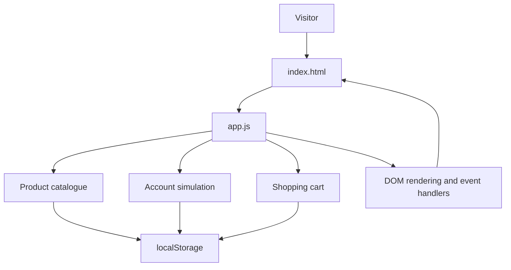

# ShopEase — Production Capstone Project & Live Deployment

ShopEase is a responsive educational e-commerce storefront capstone. It demonstrates a product catalogue, simulated account flow, product CRUD, cart operations and persistent browser state.

> **Important security note:** This is a front-end learning demo. The sign-in flow is simulated and does not verify identity. It does not store the passcode. Do not use real credentials or personal data. There is no real payment processing, server, database, inventory service or production authentication.

## Capstone requirements demonstrated

- **Authentication simulation:** Demo account dialog accepts a display name and email and remembers those fields in this browser. It is not secure authentication.
- **Interactive catalogue:** Search by product name, description and category; filter categories; sort by price or name.
- **CRUD operations:** Create, read, update and delete catalogue products.
- **Cart:** Add items, adjust quantities, remove items by reducing quantity to zero, view total and place a simulated order.
- **Persistent state:** Products, cart and demo display profile are stored using `localStorage`.
- **Responsive design:** Mobile-first layout adapts to narrow phones, tablets and desktops.
- **Accessible interaction:** Semantic page landmarks, labelled controls, dialog labels, live status region and keyboard-operable buttons.

## Project structure

```text
production-capstone-shopease-task06/
├── index.html
├── style.css
├── app.js
└── README.md
```

## Architecture



### State flow

1. On page load, `app.js` reads products, cart and demo profile from `localStorage`.
2. If no saved product list exists, the starter catalogue is used.
3. User actions update in-memory state.
4. Updated state is saved to `localStorage`.
5. The relevant UI is re-rendered without a full-page reload.

## Run locally

This project uses browser JavaScript modules. Use a local server instead of opening the HTML file directly.

### VS Code Live Server
1. Extract the ZIP file.
2. Open the project folder in VS Code.
3. Start the Live Server extension from `index.html`.

### Python local server
Run this command inside the project folder:

```bash
python -m http.server 8000
```

Open `http://localhost:8000`.

## Test checklist

- [ ] Sign in using sample/demo information (do not use a real password).
- [ ] Confirm the header greets the demo account; sign out.
- [ ] Search for a product and clear the search.
- [ ] Filter by each category and sort the results.
- [ ] Add multiple products to the bag.
- [ ] Increase and decrease cart quantities.
- [ ] Place a demo order and confirm the cart empties.
- [ ] Enable Manage products, add a product, edit it, then delete it.
- [ ] Refresh the page and verify saved products/cart/profile persist.
- [ ] Test responsive layouts at 320px, 768px, 1024px and 1440px.
- [ ] Check browser console for errors.

## Deploy with GitHub Pages

1. Create a **public** GitHub repository named `production-capstone-shopease-task06`.
2. Upload `index.html`, `style.css`, `app.js` and `README.md` to the repository root.
3. Open **Settings → Pages**.
4. Under **Build and deployment**, select **Deploy from a branch**.
5. Choose branch `main` and folder `/ (root)`, then save.
6. Wait for GitHub Pages to publish. Copy the public URL shown in the Pages section.
7. Open the URL in a private/incognito browser window to verify it loads.
8. Submit both the GitHub repository URL and live deployed URL to the academy.

## Suggested proof screenshots

Save screenshots in a `screenshots/` folder in your repository:
- `desktop-home.png` — full catalogue at 1440px
- `mobile-home.png` — layout at 320px or 375px
- `cart.png` — cart with sample items
- `product-management.png` — add/edit/delete management controls

## Production upgrade ideas

For a real production service, replace the simulated account and localStorage-only data with a secure backend, hashed passwords, authenticated sessions, database-backed products and carts, server-side validation, authorization for product management, HTTPS, and a trusted payment provider. Never store passwords or payment details in browser localStorage.
